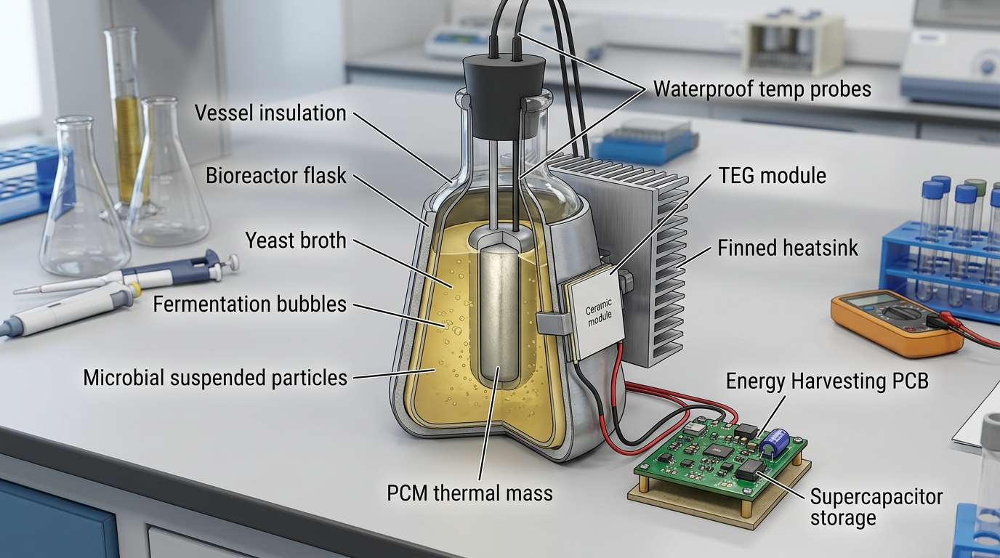
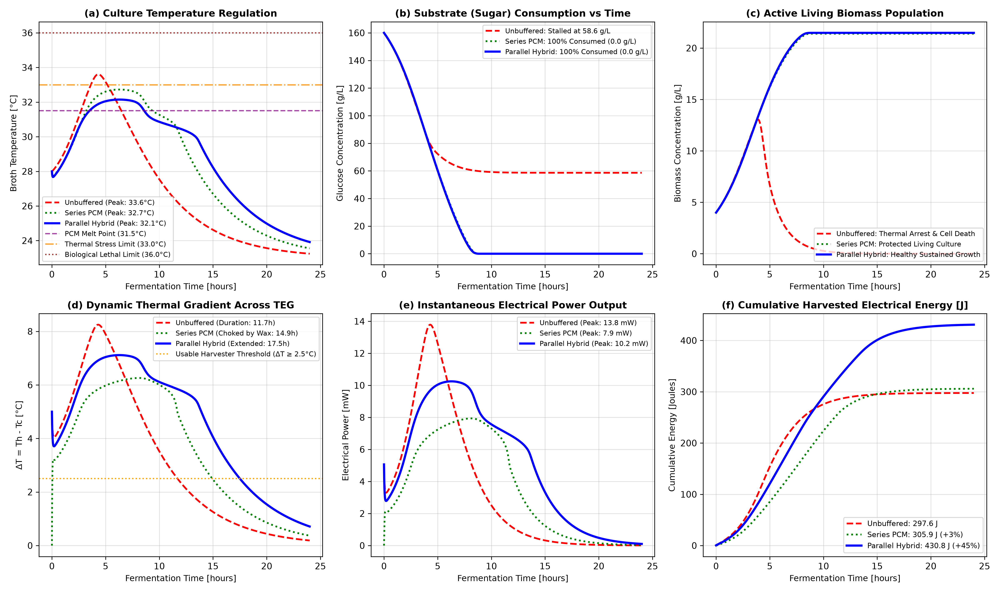

# Bio-Thermal Energy Harvester: Parallel-Hybrid PCM-TEG Architecture

[](https://www.python.org/downloads/)
[](https://opensource.org/licenses/MIT)
[](https://scipy.org/)
[](https://docs.python.org/3/library/tkinter.html)

A computational multi-physics simulator, digital twin GUI, and cyber-physical architecture for **microbial thermoelectric energy harvesting** using a **parallel phase-change material (PCM) thermal buffer**.

---

## 🔬 Overview & Scientific Motivation

Microbial fermentation (*Saccharomyces cerevisiae*) releases metabolic heat via exothermic glycolysis ($\Delta H \approx 655\text{ J/g glucose}$). Thermoelectric generators (TEGs) can convert this biological temperature gradient into usable electrical power via the Seebeck effect.

### The Biological Paradox:
1. **Unbuffered Direct Harvesting:** In high-density, insulated fermentation, unrestrained self-heating drives culture temperature beyond the biological stress threshold ($>33.0^\circ\text{C}$). The yeast suffers **irreversible enzymatic denaturation and thermal cell death**, leading to **stuck fermentation** where $30\text{--}60\text{ g/L}$ of sugar remains unfermented, cutting power short.
2. **Series-Buffered Harvesting:** Placing a phase change material (PCM) directly between the broth and the TEG protects the yeast from overheating, but solid paraffin wax has low thermal conductivity ($k \approx 0.2\text{ W/(m}\cdot\text{K)}$). It acts as a thermal insulator that starves the TEG of heat flux.
3. **The Solution: Parallel-Hybrid Architecture:** Heat generated by fermentation splits into **two parallel branches**:
   - **Branch 1 (Direct Conduction):** Broth conducts heat directly to the vessel wall TEG module for immediate electrical generation.
   - **Branch 2 (Thermal Storage):** A submerged central PCM capsule melts at $31.5^\circ\text{C}$, absorbing the peak heat wave to keep broth safely below $32.2^\circ\text{C}$.
   - **Post-Peak Discharge:** Once sugar is exhausted, the liquid PCM slowly solidifies, releasing its stored latent heat back into the broth and sustaining TEG power for an extra $5.8\text{ hours}$.

---

## 🛠️ Hardware Prototype Architecture



### System Components:
* **Bioreactor Flask:** 500 mL double-walled insulated vessel ($R_{\text{insul}} = 85.0\text{ K/W}$).
* **Substrate & Inoculum:** $160.0\text{ g/L}$ glucose mash pitched with $4.0\text{ g/L}$ active dry yeast.
* **Submerged PCM Capsule:** Central sealed aluminum capsule containing $90\text{ g}$ organic paraffin (melting point $31.5^\circ\text{C}$, $L_f = 200\text{ kJ/kg}$).
* **Thermoelectric Transducer:** SP1848-27145 module ($40 \times 40\text{ mm}$, $S = 0.045\text{ V/K}$, $R_{\text{int}} = 2.5\ \Omega$) clamped with thermal paste.
* **Cold-Side Heatsink:** Finned aluminum convective heatsink ($R_{\text{sink}} = 2.0\text{ K/W}$) exposed to ambient air ($23^\circ\text{C}$).
* **Energy Harvesting PMIC:** TI BQ25570 nano-power boost charger with cold-start from $100\text{ mV}$.
* **Energy Storage Buffer:** 5.5V, 1.0F supercapacitor powering an embedded duty-cycled IoT telemetry node.

---

## 📐 Mathematical Formulation & Governing Equations

The digital twin dynamically solves coupled non-linear Ordinary Differential Equations (ODEs) using the implicit `Radau` IIA stiff numerical integrator:

### 1. Microbial Growth Kinetics (Rosso Cardinal Temperature Model)
$$\mu(T) = \mu_{\text{opt}} \cdot \frac{(T - T_{\text{lethal}})(T - T_{\text{min}})^2}{(T_{\text{opt}} - T_{\text{min}})\left[(T_{\text{opt}} - T_{\text{min}})(T - T_{\text{opt}}) - (T_{\text{opt}} - T_{\text{lethal}})(T_{\text{opt}} + T_{\text{min}} - 2T)\right]}$$

### 2. Irreversible Thermal Denaturation & Cell Viability
$$\frac{dV_{\text{viab}}}{dt} = -k_{\text{inact}} \cdot \max(0, T_b - T_{\text{safe}})^{1.8} \cdot \frac{V_{\text{viab}}}{3600}$$
$$\frac{dX}{dt} = \left[\mu(T_b) \cdot \frac{S}{K_s + S} \cdot V_{\text{active}} \cdot \left(1 - \frac{X}{X_{\text{max}}}\right) - k_d \cdot X\right] \frac{1}{3600}$$

### 3. Substrate Depletion & Biological Heat Release
$$\frac{dS}{dt} = \left[-\frac{1}{Y_{X/S}} \left(\frac{dX}{dt}\right)_{\text{growth}} - q_{\text{etoh}} \cdot V_{\text{active}} \cdot X \cdot \frac{S}{K_s + S} - m_s \cdot V_{\text{active}} \cdot X\right] \frac{1}{3600}$$
$$Q_{\text{bio}} = V_{\text{broth}} \cdot \Delta H_{\text{glyc}} \cdot \left(-\frac{dS}{dt}\right)$$

### 4. PCM Apparent Heat Capacity (Stefan Problem Formulation)
$$C_{\text{pcm}}(T) = m_{\text{pcm}} \left[C_{p,\text{pcm}} + L_f \cdot \frac{1}{\sigma \sqrt{2\pi}} \exp\left(-\frac{(T - T_{\text{melt}})^2}{2\sigma^2}\right)\right]$$

### 5. Thermal Circuit & Thermoelectric Transduction
$$C_{\text{broth}} \frac{dT_b}{dt} = Q_{\text{bio}} - \frac{T_b - T_{\text{amb}}}{R_{\text{insul}}} - \frac{T_b - T_c}{R_{\text{b\_teg}} + R_{\text{th\_teg}} + R_{\text{contact}}} - \frac{T_b - T_{\text{pcm}}}{R_{\text{b\_pcm}}}$$
$$V_{\text{oc}} = S_{\text{teg}} \cdot (T_b - T_c), \quad P = \frac{V_{\text{oc}}^2}{4 R_{\text{int}}}, \quad E_{\text{total}} = \int P(t) \, dt$$

---

## 📊 Benchmark Results

Simulation benchmark across a 24-hour cycle ($T_{\text{amb}} = 23^\circ\text{C}$, $T_{\text{pitch}} = 28^\circ\text{C}$):

| Evaluation Dimension | 🔴 Unbuffered Baseline | 🟢 Series PCM Buffer | 🔵 Parallel Hybrid |
| :--- | :---: | :---: | :---: |
| **Peak Broth Temperature** | **$33.61^\circ\text{C}$** *(Overheats!)* | $32.73^\circ\text{C}$ | **$32.15^\circ\text{C}$** *(PCM Clamped)* |
| **Substrate Consumed** | **$101.4\text{ g/L}$** | $160.0\text{ g/L}$ | **$160.0\text{ g/L}$** |
| **Unconsumed Residual Sugar** | **$58.6\text{ g/L}$** *(Stalled!)* | **$0.0\text{ g/L}$** *(100% used)* | **$0.0\text{ g/L}$** *(100% used)* |
| **Final Active Biomass** | **$0.00\text{ g/L}$** *(Cell Death)* | $21.40\text{ g/L}$ *(Protected)* | **$21.48\text{ g/L}$** *(Healthy)* |
| **Peak TEG $\Delta T$** | $8.25^\circ\text{C}$ | $6.26^\circ\text{C}$ | $7.11^\circ\text{C}$ |
| **Peak Electrical Power** | $13.79\text{ mW}$ | $7.93\text{ mW}$ | $10.25\text{ mW}$ |
| **Usable Duration ($\Delta T \ge 2.5^\circ\text{C}$)** | $11.70\text{ hours}$ | $14.88\text{ hours}$ | **$17.50\text{ hours}$** *(+5.8 hrs!)* |
| **Total Harvested Electrical Energy** | **$297.56\text{ J}$** | **$305.88\text{ J}$** ($+2.8\%$) | **$430.83\text{ J}$** |
| **Net Electrical Gain vs Baseline** | *Reference Baseline* | $+2.8\%$ | **$+44.8\%$** |



---

## 🚀 Getting Started

### 1. Prerequisites
Clone the repository and install dependencies:
```bash
git clone https://github.com/<your-username>/Bio-Energy-Hybrid-Harvester.git
cd Bio-Energy-Hybrid-Harvester
pip install -r requirements.txt
```

### 2. Run Interactive Desktop Digital Twin (GUI)
Launch the 6-panel live simulator with interactive sliders and real-time animation:
```bash
python yeast_hybrid_teg_gui.py
```
* **Sliders:** Adjust glucose concentration, PCM mass, vessel insulation ($R_{\text{insul}}$), and ambient temperature.
* **⚡ Recompute System:** Recalculates coupled ODEs in real-time.
* **▶ Play 24h Animation:** Hour-by-hour visual demonstration of the system dynamics.

### 3. Run Headless Script & Export High-Res Figures
```bash
python yeast_hybrid_teg_sim.py
```
Solves all three architectural models and automatically exports `tri_system_comprehensive_comparison.png` at 300 DPI.

### 4. Run Web Dashboard
```bash
streamlit run app.py
```

---

## 📁 Repository Structure

```
Bio-Energy-Hybrid-Harvester/
├── yeast_hybrid_teg_sim.py            # Primary tri-system ODE simulation & benchmark script
├── yeast_hybrid_teg_gui.py            # Interactive 6-panel Tkinter Digital Twin GUI
├── app.py                             # Streamlit cloud-deployable web dashboard
├── yeast_pcm_teg_simulation.ipynb     # Jupyter notebook for research exploration
├── hybrid_harvester_hardware_setup.jpg# 3D technical prototype hardware render
├── tri_system_comprehensive_comparison.png # High-res 6-panel benchmark comparison figure
├── requirements.txt                   # Python environment dependencies
├── .gitignore                         # Standard Python / IDE exclusions
└── README.md                          # Full academic documentation & user guide
```

---

## 📜 Citation & Academic Use

If you use this model or code in your research or capstone project, please cite:

```bibtex
@article{yeast_hybrid_teg_2026,
  title={Parallel Phase-Change Thermal Buffering for Biological Thermoelectric Energy Harvesting and Stuck-Fermentation Prevention},
  author={Your Name},
  journal={Bio-Energy Multi-Physics Research},
  year={2026}
}
```

---

## 📄 License
This project is licensed under the MIT License - see the LICENSE file for details.
