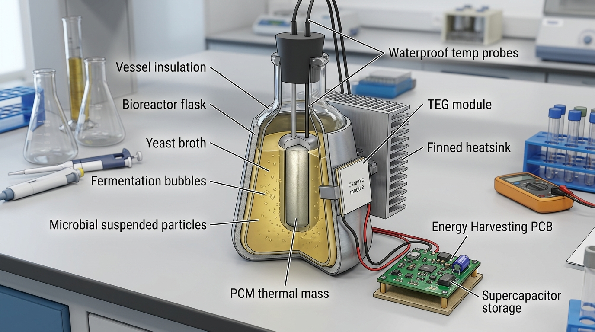
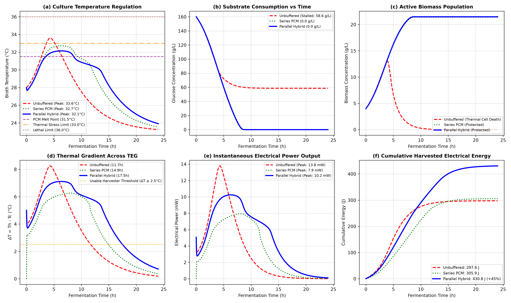

# Bio-Thermal Energy Harvester: Parallel-Hybrid PCM-TEG Architecture

[](https://www.python.org/downloads/)
[](https://opensource.org/licenses/MIT)

Simulation models and analysis for harvesting thermoelectric power from yeast (*Saccharomyces cerevisiae*) fermentation. This project models how a parallel phase-change material (PCM) buffer prevents stuck fermentation caused by self-heating while maintaining heat flow to a thermoelectric generator (TEG).

---

## Background and Motivation

Yeast fermentation releases metabolic heat as glucose is consumed (~655 J per gram of glucose). In an insulated bioreactor, this heat accumulates quickly:

1. **Unbuffered system:** Broth temperature rises past 33 °C during peak fermentation. At this temperature, yeast cells suffer thermal stress and lose viability. Fermentation halts early ("stuck fermentation"), leaving ~58 g/L of sugar unfermented and cutting power generation short.
2. **Series PCM buffer:** Placing paraffin wax between the broth and the TEG protects the culture from overheating. However, solid paraffin has low thermal conductivity (~0.2 W/m·K), which creates a large thermal resistance that chokes heat flow to the TEG and drops electrical output.
3. **Parallel hybrid (this work):** Heat splits into two separate paths:
   - The broth directly contacts the TEG on the vessel wall to maintain a good temperature difference ($\Delta T$).
   - A submerged PCM capsule (melting at 31.5 °C) absorbs excess heat during peak fermentation, keeping broth temperature below 32.2 °C.
   - Once glucose is exhausted, the molten PCM solidifies and releases its latent heat back into the broth, keeping the TEG running for an extra ~5.8 hours.

---

## System Architecture

```
                     Parallel Hybrid Thermal-Electrical Layout

           ┌────────────────────────────────────────────────────────┐
           │     Microbial Broth (Saccharomyces cerevisiae)         │
           │        Glycolytic Heat Generation Q_bio (655 J/g)      │
           └──────────────┬──────────────────────────┬──────────────┘
                          │                          │
                 Branch 1 │ (Direct Conduction)      │ Branch 2 (Thermal Storage)
                          ▼                          ▼
               ┌──────────────────────┐   ┌──────────────────────────┐
               │ Vessel Wall Interface│   │ Submerged PCM Capsule    │
               │ (Direct Heat Flux)   │   │ - Organic Paraffin (90g) │
               └──────────┬───────────┘   │ - Melting Point: 31.5 °C │
                          ▼               │ - Latent Heat: 200 kJ/kg │
               ┌──────────────────────┐   └──────────┬───────────────┘
               │ Thermoelectric Gen.  │              │ Keeps T_broth <= 32.2 °C
               │ (SP1848-27145 TEG)   │              │ Discharges latent heat
               └──────────┬───────────┘              │ back to broth post-peak
                          ▼                          ▼
               ┌──────────────────────┐   ┌──────────────────────────┐
               │ Finned Heat Sink     │   │ Extended Power Harvest   │
               │ R_sink = 2.0 K/W     │   │ +5.8h Usable Operation   │
               └──────────┬───────────┘   └──────────────────────────┘
                          ▼
               ┌──────────────────────┐
               │ Ambient Air (23 °C)  │
               └──────────────────────┘
```



### Hardware Setup:
* **Bioreactor:** 500 mL double-walled insulated vessel ($R_{\text{insul}} = 85.0\text{ K/W}$)
* **Broth:** 160 g/L glucose pitched with 4.0 g/L active dry yeast
* **PCM Capsule:** Central sealed aluminum capsule with 90 g organic paraffin ($T_{\text{melt}} = 31.5^\circ\text{C}$, $L_f = 200\text{ kJ/kg}$)
* **TEG Module:** SP1848-27145 module ($40 \times 40\text{ mm}$, $S = 0.045\text{ V/K}$, $R_{\text{int}} = 2.5\ \Omega$)
* **Heat Sink:** Finned aluminum heat sink ($R_{\text{sink}} = 2.0\text{ K/W}$) in ambient air ($23^\circ\text{C}$)
* **Power Management:** Modeled after TI BQ25570 boost converter with supercapacitor storage

---

## Mathematical Model

The simulation couples non-linear ODEs solved using SciPy's implicit Radau solver:

### 1. Microbial Growth Kinetics (Rosso Model)
$$\mu(T) = \mu_{\text{opt}} \cdot \frac{(T - T_{\text{lethal}})(T - T_{\text{min}})^2}{(T_{\text{opt}} - T_{\text{min}})\left[(T_{\text{opt}} - T_{\text{min}})(T - T_{\text{opt}}) - (T_{\text{opt}} - T_{\text{lethal}})(T_{\text{opt}} + T_{\text{min}} - 2T)\right]}$$

### 2. Thermal Inactivation and Cell Viability
$$\frac{dV_{\text{viab}}}{dt} = -k_{\text{inact}} \cdot \max(0, T_b - T_{\text{safe}})^{1.8} \cdot \frac{V_{\text{viab}}}{3600}$$

$$\frac{dX}{dt} = \left[\mu(T_b) \cdot \frac{S}{K_s + S} \cdot V_{\text{active}} \cdot \left(1 - \frac{X}{X_{\text{max}}}\right) - k_d \cdot X\right] \frac{1}{3600}$$

### 3. Glucose Depletion and Heat Generation
$$\frac{dS}{dt} = \left[-\frac{1}{Y_{X/S}} \left(\frac{dX}{dt}\right)_{\text{growth}} - q_{\text{etoh}} \cdot V_{\text{active}} \cdot X \cdot \frac{S}{K_s + S} - m_s \cdot V_{\text{active}} \cdot X\right] \frac{1}{3600}$$

$$Q_{\text{bio}} = V_{\text{broth}} \cdot \Delta H_{\text{glyc}} \cdot \left(-\frac{dS}{dt}\right)$$

### 4. Phase Change Material Latent Heat
$$C_{\text{pcm}}(T) = m_{\text{pcm}} \left[C_{p,\text{pcm}} + L_f \cdot \frac{1}{\sigma \sqrt{2\pi}} \exp\left(-\frac{(T - T_{\text{melt}})^2}{2\sigma^2}\right)\right]$$

### 5. Thermal Balance and TEG Power
$$C_{\text{broth}} \frac{dT_b}{dt} = Q_{\text{bio}} - \frac{T_b - T_{\text{amb}}}{R_{\text{insul}}} - \frac{T_b - T_c}{R_{\text{b\_teg}} + R_{\text{th\_teg}} + R_{\text{contact}}} - \frac{T_b - T_{\text{pcm}}}{R_{\text{b\_pcm}}}$$

$$V_{\text{oc}} = S_{\text{teg}} \cdot (T_b - T_c), \quad P = \frac{V_{\text{oc}}^2}{4 R_{\text{int}}}, \quad E = \int P(t) \, dt$$

---

## Simulation Results

24-hour simulation run at $T_{\text{amb}} = 23^\circ\text{C}$ and $T_{\text{pitch}} = 28^\circ\text{C}$:

| Metric | Unbuffered Baseline | Series PCM Buffer | Parallel Hybrid |
| :--- | :---: | :---: | :---: |
| Peak Broth Temperature | 33.61 °C | 32.73 °C | 32.15 °C |
| Glucose Consumed | 101.4 g/L | 160.0 g/L | 160.0 g/L |
| Residual Glucose (Unfermented) | 58.6 g/L | 0.0 g/L | 0.0 g/L |
| Final Biomass | 0.00 g/L | 21.40 g/L | 21.48 g/L |
| Peak TEG Delta-T | 8.25 °C | 6.26 °C | 7.11 °C |
| Peak Electrical Power | 13.79 mW | 7.93 mW | 10.25 mW |
| Usable Duration (Delta-T >= 2.5 °C) | 11.70 hours | 14.88 hours | 17.50 hours |
| Total Harvested Electrical Energy | 297.56 J | 305.88 J | 430.83 J |
| Net Gain vs Baseline | Reference | +2.8% | +44.8% |



In the unbuffered baseline, fermentation self-heats past 33 °C, causing cell death and leaving 58.6 g/L sugar unfermented. Placing PCM in series prevents overheating but restricts heat conduction. The parallel-hybrid architecture keeps broth temperature below 32.2 °C, completes fermentation, and increases total harvested energy by 44.8% (430.8 J vs 297.6 J) while extending usable generation by 5.8 hours.

---

## How to Run

### 1. Setup
```bash
git clone https://github.com/hanwithabandi-droid/Bio-Energy-Hybrid-Harvester.git
cd Bio-Energy-Hybrid-Harvester
pip install -r requirements.txt
```

### 2. Desktop GUI
Run the Tkinter desktop simulator to adjust parameters with sliders:
```bash
python yeast_hybrid_teg_gui.py
```

### 3. Simulation Script
Run the ODE solver and export the 6-panel comparison figure:
```bash
python yeast_hybrid_teg_sim.py
```

### 4. Streamlit Dashboard
Run the web dashboard:
```bash
streamlit run app.py
```

---

## Repository Structure

```
Bio-Energy-Hybrid-Harvester/
├── yeast_hybrid_teg_sim.py            # Tri-system ODE simulation and plotting script
├── yeast_hybrid_teg_gui.py            # Desktop GUI for interactive parameter exploration
├── app.py                             # Streamlit web dashboard
├── yeast_pcm_teg_simulation.ipynb     # Jupyter notebook
├── hybrid_harvester_hardware_setup.jpg# Hardware setup photo and schematic
├── tri_system_comprehensive_comparison.png # 6-panel comparison plot
├── requirements.txt                   # Dependencies
├── .gitignore                         # Git ignore
├── LICENSE                            # MIT License
├── CITATION.cff                       # Citation metadata
└── README.md                          # Documentation
```

---

## Citation

```bibtex
@misc{bandi2026bioenergy,
  author       = {Bandi Hanwitha and Somineni Rishi Nandhan},
  title        = {Parallel Phase-Change Thermal Buffering for Biological Thermoelectric Energy Harvesting and Stuck-Fermentation Prevention},
  year         = {2026},
  howpublished = {\url{https://github.com/hanwithabandi-droid/Bio-Energy-Hybrid-Harvester}},
  note         = {Research Manuscript / Open Benchmark}
}
```

---

## License

This project is licensed under the MIT License - see the [LICENSE](LICENSE) file for details.
